# VCA — Verified Card Authority | Manufacturer CAD & Engineering Specification

**Reference Prototype Identity:** `VCA-26-00202`  
**Manufacturing & Engineering Inquiries:** [tosmond@vcaslabs.com](mailto:tosmond@vcaslabs.com)  
**Brand Portal:** [https://vcaslabs.com](https://vcaslabs.com) · **CAD Repository:** https://github.com/vcaslabs/vca-slab-cad  
**Interactive CAD Workstations (No Video Tools):** [Open Live README Page (3D Embedded)](https://ais-pre-moxeqy5i7vkzhyeitul3k6-7364581088.us-west2.run.app/?serial=VCA-26-00202&mode=readme) · [Launch Live 3D CAD Viewport](https://ais-pre-moxeqy5i7vkzhyeitul3k6-7364581088.us-west2.run.app/?serial=VCA-26-00202&embed=blueprint&style=exploded-blueprint&view=exploded&explode=1&callouts=1&hud=1&animate=1) · [Launch Full CAD Studio (`?mode=cad-only`)](https://ais-pre-moxeqy5i7vkzhyeitul3k6-7364581088.us-west2.run.app/?serial=VCA-26-00202&mode=cad-only)

---

## Live 3D Animated Slab CAD Preview (Transparent Housing, Front/Back Labels & 13.56 MHz NFC)

> Embedded directly below as a self-contained animated 3D CAD vector (`./public/vca-slab-animated-3d.svg`) showing the water-clear optical polycarbonate shell, Classic VCA Blue & Red certification label, NFC inlay, and 12-layer Z-axis explosion. Click the preview to launch the interactive Three.js 3D viewport or open the [Live Interactive README Page](https://ais-pre-moxeqy5i7vkzhyeitul3k6-7364581088.us-west2.run.app/?serial=VCA-26-00202&mode=readme).

[](https://ais-pre-moxeqy5i7vkzhyeitul3k6-7364581088.us-west2.run.app/?serial=VCA-26-00202&embed=blueprint&style=exploded-blueprint&view=exploded&explode=1&callouts=1&hud=1&animate=1)

---

## Direct Manufacturer Contact & DFM Submission

- **Primary Engineering & RFQ Contact:** [tosmond@vcaslabs.com](mailto:tosmond@vcaslabs.com?subject=VCA%20Slab%20Manufacturing%20%26%20DFM%20Inquiry%20%E2%80%94%20VCA-26-00202)
- **Live Synced README Endpoint:** [View / Fetch Raw Dynamic `README.md`](https://ais-pre-moxeqy5i7vkzhyeitul3k6-7364581088.us-west2.run.app/api/cad/README.md?serial=VCA-26-00202&email=tosmond%40vcaslabs.com)
- **Critical Specification Status:** All tolerances, shrinkage allowances, wall thicknesses, and RF coupling figures below are **Proposed Engineering Targets** generated by the VCA Parametric CAD Workstation. Hardened steel cavity cuts, gate locations, hot-runner manifold design, and SPI optical surface grades **require formal vendor DFM confirmation** prior to tooling release.

---

## 1. One-Click Manufacturer CAD & Documentation Downloads

Download live, parameter-synced fabrication files directly from the links below:

| Package Artifact | Format | Description | Direct Download |
| --- | --- | --- | --- |
| **3D Exterior Housing Mesh** | `.stl` (ASCII) | Watertight chamfered VCA shell (`84.0 × 138.0 × 6.8 mm`) | [Download `VCA-26-00202-housing.stl`](https://ais-pre-moxeqy5i7vkzhyeitul3k6-7364581088.us-west2.run.app/api/cad/housing.stl?serial=VCA-26-00202) |
| **2D Precision CAD Profile** | `.dxf` (AutoCAD R12) | Multi-layer profiles: `OUTLINE`, `CAVITY`, `LABEL_BAY`, `NFC_POCKET` | [Download `VCA-26-00202-profile.dxf`](https://ais-pre-moxeqy5i7vkzhyeitul3k6-7364581088.us-west2.run.app/api/cad/profile.dxf?serial=VCA-26-00202) |
| **Parametric B-Rep CAD Source** | `.scad` (OpenSCAD / FreeCAD) | Editable solid assembly script ready for STEP AP214 / IGES export | [Download `VCA-26-00202-parametric.scad`](https://ais-pre-moxeqy5i7vkzhyeitul3k6-7364581088.us-west2.run.app/api/cad/parametric.scad?serial=VCA-26-00202) |
| **Bill of Materials (BOM)** | `.csv` | Itemized housing shells, collar, NFC inlay, archival label, and tamper seal | [Download `VCA-26-00202-bom.csv`](https://ais-pre-moxeqy5i7vkzhyeitul3k6-7364581088.us-west2.run.app/api/cad/bom.csv?serial=VCA-26-00202) |
| **Manufacturer RFQ & Tooling Brief** | `.md` | Complete injection-moulding, RF, and ultrasonic welding RFQ dossier | [Download `VCA-26-00202-manufacturer-rfq.md`](https://ais-pre-moxeqy5i7vkzhyeitul3k6-7364581088.us-west2.run.app/api/cad/manufacturer-rfq.md?serial=VCA-26-00202&email=tosmond%40vcaslabs.com) |
| **2D Orthographic CAD Blueprint** | `.svg` | Full orthographic front elevation + Z-axis stackup drawing | [Download `VCA-26-00202-blueprint.svg`](https://ais-pre-moxeqy5i7vkzhyeitul3k6-7364581088.us-west2.run.app/api/blueprint.svg?serial=VCA-26-00202&style=exploded-blueprint&view=exploded&explode=1&hud=1) |
| **Live 3D Animated CAD Graphic** | `.svg` (Animated) | Embeddable isometric animated 3D exploded CAD preview | [Download `VCA-26-00202-animated-3d.svg`](https://ais-pre-moxeqy5i7vkzhyeitul3k6-7364581088.us-west2.run.app/api/cad-animated.svg?serial=VCA-26-00202) |
| **Dynamic Manufacturer README** | `.md` | Live parameter-driven copy of this README document | [Download `README.md`](https://ais-pre-moxeqy5i7vkzhyeitul3k6-7364581088.us-west2.run.app/api/cad/README.md?serial=VCA-26-00202&email=tosmond%40vcaslabs.com&download=1) |

---

## 2. Enclosure, Polymer & Injection-Moulding Requirements

| Engineering Parameter | Proposed Target | Tooling & Vendor Confirmation Notes |
| --- | --- | --- |
| **Overall Exterior Envelope** | `84.00 × 138.00 × 6.80 mm` | VCA chamfered upper shoulder silhouette (`8.5 mm` chamfer, `R4.5 mm`) |
| **Primary Optical Resin** | `Optical Polycarbonate (PC)` | Proposed grade: `Covestro Makrolon LQ3187 / SABIC Lexan OQ1028 (Proposed)` (Transmittance `89%`, Haze `< 0.7%`) |
| **Nominal Shell Wall Thickness** | `1.85 mm` | Minimum structural floor behind NFC recess: `3.85 mm` |
| **Optical Viewing Window Finish** | `SPI A-1 Diamond Polish` | Perimeter collar matte texture `VDI 24–27` (EDM finish) |
| **Minimum Draft Angle** | `1.5°` | Required on optical core walls to eliminate ejection scuffing |
| **General Dimensional Tolerance** | `±0.05 mm` | ISO 2768-m / DIN 16742 TG4 (Confirm critical datum flatness w/ moulder) |
| **Shrinkage Allowance & Tool Cavity** | `0.6%` (`84.504 × 138.828 mm`) | Estimated shot volume `59.44 cm³`, part mass `73.2 g` |
| **Projected Area & Press Est.** | `115.7 cm²` (~120 US Tons) | 2-cavity hardened S136 / Stavax stainless optical tooling recommended (confirm w/ moulder) |

---

## 3. Card Cavity, Tamper-Evident Weld & NFC Hardware Requirements

### Internal Card Protection & Tamper-Evident Joining
- **Target Card Envelope:** `63.50 × 88.90 × 0.31 mm` (Archival inner sleeve: `Enabled`)
- **Moulded Card Cavity Envelope:** `65.9 × 91.3 × 0.66 mm` (Zero-pinch Z-axis play: `0.25 mm`, corner relief `R1.40 mm`)
- **Ultrasonic Perimeter Fusion:** `20 kHz` hermetic weld utilizing a `0.75 × 0.55 mm` 45° triangular energy director
- **Interlock & Anti-Pry Architecture:** `1.15 mm` tongue-and-groove perimeter seat plus **4 frangible corner micro-shear alignment pins** (`Ø 1.80 mm`) and destructible diffractive hologram / QR void seal

### Integrated 13.56 MHz NFC Access Hardware
- **NFC IC Specification:** `NXP NTAG424 DNA (AES-128 SUN)` (ISO/IEC 14443-A)
- **Recessed Isolation Bay:** `22.00 × 22.00 × 1.10 mm` (sealed in upper label compartment)
- **Planar Copper Spiral Antenna:** `18.5 × 18.5 mm`, `6` turns (`0.25 mm` trace width / `0.22 mm` gap, `35 µm` Cu on polyimide flex)
- **Calculated RF Parameters:** `1.11 µH` inductance · `124.1 pF` tuning capacitance @ `13.56 MHz` · Estimated closed-slab smartphone read distance ~`22.6 mm`
- **Architectural Boundary:** The NFC chip operates strictly as a hardware-bound cryptographic access key. The digital certificate / NFT record lives off-chip.

---

## 4. VCA Certification Label Prototype Specification (Front & Back)

| Label Surface | Security Feature | Manufacturing & Graphic Specification |
| --- | --- | --- |
| **Envelope & Carrier** | Dual-Sided Archival Insert | `72.0 × 25.0 × 0.86 mm` Teslin / synthetic security stock housing the sealed 13.56 MHz NFC coil & IC inside the label carrier |
| **Front (+Z)** | Classic VCA Blue & Red Split Trim | Royal Blue (`#0A2E73`) left / Crimson Red (`#B91C1C`) right perimeter frame with metallic chrome bevel |
| **Front (+Z)** | Fugitive-Ink Guilloche & Barcode | Pearl-white anti-tamper cyan guilloche pattern, card title & set, Code-128 1D barcode, centered chrome `VCA` hologram seal, right-aligned collector #, `VCA 10 · GEM MINT`, and `VCA-26-00202` |
| **Back (-Z)** | Midnight-Navy UV VCA Watermark | Repeating UV `VCA` security pattern + metallic silver `VCA` crest on upper-left band |
| **Back (-Z)** | Prismatic Hologram Shield & QR | Center prismatic rainbow/silver `VCA` shield + upper-right white rounded ECC-H QR box (`vcaslabs.com/v/VCA-26-00202`) + lower fugitive-ink strip with 1D barcode & serial |

---

## 5. Bill of Materials (BOM)

| Item | Part Number | Description | Material | Qty | Mass | Process | Status |
| --- | --- | --- | --- | --- | --- | --- | --- |
| 1 | `VCA-HSG-FRT-01` | Front Optical Housing (84x138 mm) | Covestro Makrolon LQ3187 / SABIC Lexan OQ1028 (Proposed) | 1 | 31.38 g | Injection Moulding (SPI A-1 Optical) | Confirm w/ Moulder |
| 2 | `VCA-HSG-RER-02` | Rear Optical Housing w/ Integral Card Cradle & NFC Pocket | Covestro Makrolon LQ3187 / SABIC Lexan OQ1028 (Proposed) | 1 | 31.38 g | Injection Moulding (SPI A-1 / VDI 24) | Confirm w/ Moulder |
| 3 | `VCA-BZL-GRP-03` | Graphite Chamfered Perimeter Frame Collar | PC/ABS Graphite-Filled Black (UL94 V-0) | 1 | 8.56 g | 2-Shot Overmould / Insert | Confirm w/ Moulder |
| 4 | `VCA-NFC-424-04` | NTAG424 DNA AES-128 Inlay (18.5x18.5 mm, 6T) | NXP IC Die + 35µm Cu / 50µm Polyimide Flex | 1 | 0.42 g | Etched Flex + Flip-Chip + PSA | Confirm w/ Inlay Vendor |
| 5 | `VCA-LBL-CRT-05` | Laser-Serialized Certification Plate (72x25 mm) | Synthetic Teslin Archival Stock | 1 | 0.35 g | Thermal Transfer + Micro-Text Print | Proposed Spec |
| 6 | `VCA-SEC-HOL-06` | Destructible Diffractive Hologram & QR Tamper Seal | Tamper-Evident Metallized PET Void Film | 1 | 0.12 g | Hot-Stamp + UV Laser Etch | Proposed Spec |
| 7 | `VCA-SLV-ARC-07` | Archival Acid-Free Inner Card Sleeve (Optional) | 50 µm Biaxially Oriented Polypropylene (PVC-Free) | 1 | 0.96 g | Ultrasonic Precision Slit | Proposed Spec |

---

## 6. Embed Options (Add This Live CAD Anywhere)

Manufacturers, partners, and documentation portals can embed the live VCA Slab CAD & Full-Spec README using any of the options below:

### Option A — Markdown Live 3D Animated CAD (GitHub, Notion, Linear, Obsidian)
```markdown
[](https://ais-pre-moxeqy5i7vkzhyeitul3k6-7364581088.us-west2.run.app/?serial=VCA-26-00202&embed=blueprint&style=exploded-blueprint&view=exploded&explode=1&callouts=1&hud=1&animate=1)
```

### Option B — Full-Spec Interactive 3D README `<iframe>` (Complete Product, Label Prototype & BOM Spec)
```html
<iframe
  src="https://ais-pre-moxeqy5i7vkzhyeitul3k6-7364581088.us-west2.run.app/?serial=VCA-26-00202&mode=readme"
  title="VCA Full Spec Dynamic README & 3D Slab — VCA-26-00202"
  width="100%"
  height="840"
  style="border:1px solid #1E3A5F;border-radius:10px;background:#0D1117;display:block;"
  loading="lazy"
  allow="fullscreen"
></iframe>
```

### Option C — Interactive 3D CAD & Blueprint `<iframe>` (Viewport Only)
```html
<iframe
  src="https://ais-pre-moxeqy5i7vkzhyeitul3k6-7364581088.us-west2.run.app/?serial=VCA-26-00202&embed=blueprint&style=exploded-blueprint&view=exploded&explode=1&callouts=1&hud=1&animate=1"
  title="VCA Slab CAD Blueprint — VCA-26-00202"
  width="100%"
  height="560"
  style="border:1px solid #1E3A5F;border-radius:8px;background:#041224;display:block;"
  loading="lazy"
  allow="fullscreen"
></iframe>
```

### Option D — Dynamic Self-Mounting Text-Box Widget (`/embed.js`)
```html
<div
  data-vca-blueprint
  data-serial="VCA-26-00202"
  data-style="exploded-blueprint"
  data-view="exploded"
  data-explode="1"
  data-callouts="1"
  data-hud="1"
  data-animate="1"
  data-height="560"
></div>
<script async src="https://ais-pre-moxeqy5i7vkzhyeitul3k6-7364581088.us-west2.run.app/embed.js"></script>
```

### Option E — Static Vector Blueprint Fallback (`<object>`)
```html
<object
  type="image/svg+xml"
  data="https://ais-pre-moxeqy5i7vkzhyeitul3k6-7364581088.us-west2.run.app/api/blueprint.svg?serial=VCA-26-00202&style=exploded-blueprint&view=exploded&explode=1&hud=1"
  aria-label="VCA Slab CAD Blueprint VCA-26-00202"
  style="width:100%;max-width:1200px;aspect-ratio:5/3;border:1px solid #1E3A5F;border-radius:8px;display:block;"
></object>
```

---

**Questions, DFM feedback, or tooling quotes?** Contact **tosmond@vcaslabs.com** · [Open Live README & Private Direct Message Overlay](https://ais-pre-moxeqy5i7vkzhyeitul3k6-7364581088.us-west2.run.app/?serial=VCA-26-00202&mode=readme) · [vcaslabs.com](https://vcaslabs.com)
